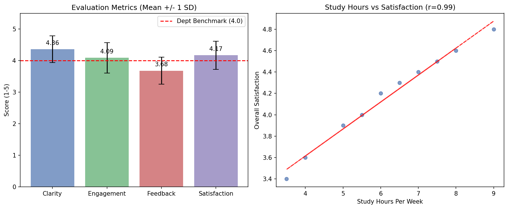

# 學系期末教學評估與質素保證檢討報告 (Departmental Course Evaluation & Quality Assurance Summary)

## 📋 執行摘要 (Executive Summary)
本報告針對本學期之學生教學評估問卷（Student Evaluation of Teaching, SET）進行量化分析。本次評估共收集 $N=10$ 位學生的有效樣本。整體而言，課程的整體滿意度（Overall Satisfaction）表現良好，平均達到 4.17 分，超越學系設定的 4.0 基準線。然而，數據亦顯示在回饋實用性（Feedback Helpfulness）方面仍有改進空間。此外，學生的每週學習時數與整體滿意度呈現極高度的正相關，顯示投入程度對學習體驗有顯著影響。

## 📊 描述性統計匯總表 (Descriptive Statistics Table)

以下為各項教學評鑑指標（5 分制）及學習時數的描述性統計（Descriptive Statistics）結果：

| 評估指標 (Metric) | 平均值 (Mean) | 標準差 (SD) | 最小值 (Min) | 最大值 (Max) |
| :--- | :---: | :---: | :---: | :---: |
| 講解清晰度 (Clarity Score) | 4.36 | 0.42 | 3.6 | 4.9 |
| 課堂參與度 (Engagement Score) | 4.09 | 0.48 | 3.2 | 4.7 |
| 回饋實用性 (Feedback Helpfulness) | 3.68 | 0.43 | 2.9 | 4.3 |
| 整體滿意度 (Overall Satisfaction) | 4.17 | 0.44 | 3.4 | 4.8 |
| 每週學習時數 (Study Hours Per Week) | 6.20 | 1.75 | 3.5 | 9.0 |

*(註：每週學習時數單位為小時，其餘指標為 1-5 分制)*

## 🔍 關鍵數據洞察 (Key Quantitative Insights)

1. **優勢項目 (Strengths)**：
   - **講解清晰度 (Clarity Score)** 表現最為突出，平均分高達 4.36（SD = 0.42），顯示導師在知識傳遞與概念解說上極具成效，能有效幫助學生掌握跨學科核心概念。
   - **整體滿意度 (Overall Satisfaction)** 達到 4.17，成功跨越學系 4.0 的基準線（Department Benchmark）。

2. **待補強痛點 (Areas for Improvement)**：
   - **回饋實用性 (Feedback Helpfulness)** 是唯一低於 4.0 基準線的指標，平均僅得 3.68 分（SD = 0.43）。這反映出學生在完成作業或形成性評量（Formative Assessment）後，可能認為所獲得的評語不夠具體，或未能有效指引他們進行下一步的修正。這將是下學期首要的改進目標。

3. **學習投入關聯分析 (Engagement & Satisfaction Correlation)**：
   - 數據顯示，**每週學習時數 (Study Hours Per Week)** 與 **整體滿意度 (Overall Satisfaction)** 之間存在極強的正相關（皮爾森相關係數 Pearson Correlation $r = 0.99$）。這意味著投入越多時間學習的學生，其課程滿意度越高；反之，低投入學生的滿意度與學習體驗則相對較差。

## 🚀 下學期具體教學行動方案 (Action Plan for Next Semester)

針對上述數據洞察，特別是「回饋實用性」偏低及「低投入學生滿意度較低」的現象，建議於下學期推行以下三項跨學科教學改進方案：

1. **引入期中形成性回饋機制 (Formative Feedback Checkpoints)**：
   - 在期末大型作業前，增設 1-2 次低佔分（Low-stakes）的期中進度檢查。利用「三明治回饋法（Sandwich Feedback Method）」，先肯定學生的初步構思，再指出論點漏洞，並提供具體的改進提示（Actionable Hints），讓學生有機會在最終遞交前進行修正。

2. **結合 AI 助教提供即時評語支架 (AI-Assisted Scaffolding)**：
   - 針對大班教學，導師可運用 AI 教學助教協助生成初步的「蘇格拉底式提問（Socratic Questioning）」評語草稿。這不僅能減輕教師批改負擔，更能確保每位學生都能獲得具體且引導批判性思考（Critical Thinking）的高質素回饋。

3. **為低投入學生設計課前微任務 (Pre-class Micro-tasks for Low-engagement Students)**：
   - 針對每週學習時數較低的學生，設計與香港在地情境（如：醫管局分流制度、強積金 MPF 政策等）結合的課前 5 分鐘微型個案閱讀或線上小測。透過降低學習門檻並提升內容關聯性，逐步建立他們的學習習慣與課堂參與度。